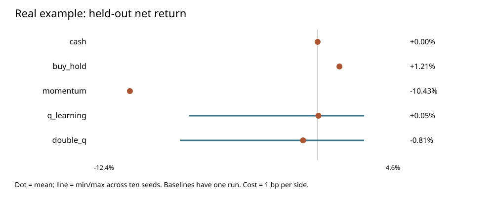

# Tabular Reinforcement Learning in C

**Maze benchmarks and a cost-aware trading experiment**, rebuilt from the
original ENSTA Paris student project by Jude Nemer Khazzaka and Taha Khn-nous.

The implementation stays procedural: ordinary C functions, structs, arrays,
and loops. No neural networks, C++ templates, or external numerical libraries.
Q-learning and Double Q-learning share one small agent implementation and run
in both environments.

## What works

- **Maze:** BFS and DFS references, safe movement, real learned-path rendering,
  separate frozen-policy evaluation, and ten independent training seeds.
- **Trading:** meaningful past-only market features, portfolio accounting,
  costs only when exposure changes, forced final liquidation, and chronological
  training/validation/test periods.
- **Evaluation:** cash, buy-and-hold, and momentum baselines; fixed-policy cost
  sensitivity; all seeds reported, rather than the best test seed.
- **Reproducibility:** included datasets, persisted Q tables and state coverage,
  saved ledgers, checksums, unit tests, sanitizers, and GitHub Actions.
- **Signals:** reload a validation-selected policy to suggest the next action.
  An action is not a predicted price or a calibrated probability.

## Executed results

Both learning algorithms solve each supplied maze optimally in **10/10 seeds**:
45 moves on the original maze and 10 on the smaller maze. Evaluation uses
greedy frozen policies. Each agent trains on the maze it is tested on; this
is not generalization to unseen layouts.

The real trading example uses **5,254 observed EUR/USD source-clock dates**
derived from the data previously supplied by the project owner. Test execution
runs from **2016-03-01 to the final liquidation open on 2020-03-18**.
At the assumed **1 bp one-way cost**:

| Policy | Test net return |
|---|---:|
| Cash | 0.00% |
| Buy-and-hold | +1.21% |
| Five-session momentum | −10.43% |
| Q-learning, mean across 10 seeds | +0.05% |
| Double Q-learning, mean across 10 seeds | −0.81% |

**Validation selects cash.** These results do not demonstrate a profitable RL
edge. The small positive average Q-learning return does not beat buy-and-hold.
On synthetic data, the simple momentum baseline also beats average learned
returns. These negative comparisons are retained deliberately.



See [all results and seed ranges](docs/RESULTS.md). Seed variability measures
training randomness on one price history, not uncertainty across independent
market histories. Costs and fill prices are assumptions, not broker quotes.

The delivered version passes **35 C checks**, clean sanitizer runs, and an
independent reconstruction of all twelve example trading ledgers.

## Build and run

Requires a C11 compiler, `make`, and the standard C/math libraries. Run from
the project root on Linux or macOS (or WSL on Windows):

```sh
make
make test
make sanitize
make reproduce
```

`make reproduce` runs both mazes and both market datasets with ten seeds.
It overwrites the corresponding result directories. A faster end-to-end run:

```sh
make smoke
```

Individual commands allow an explicit output directory and seed count:

```sh
mkdir -p results/my_maze results/my_trade
./rl maze data/maze.txt results/my_maze 10
./rl trade data/eurusd_daily.csv results/my_trade 10
```

Trading CSV format is `date,open,close`, sorted by unique ISO date. At least
120 positive-price rows are required. See [data provenance](data/README.md).
Output directories must exist; the program does not run shell commands.

## How trading works

At the next observed session's open, the agent knows the previous sessions'
closing prices and its current position. The state contains:

| Feature | Definition | Bins |
|---|---|---:|
| Recent return | Last observed close-to-close log return | 3 |
| Momentum | Five observed sessions' log return | 3 |
| Volatility | RMS of the previous 20 observed returns | 2 |
| Position | Flat or fully long | 2 |

There are **3 × 3 × 2 × 2 = 36 states**. Bin boundaries are estimated using
training data only. They remain fixed during validation and test.

Actions retain the original meaning: **BUY**, **SELL**, **HOLD**. BUY targets
100% long, SELL targets cash, HOLD keeps current exposure. Repeating BUY while
already long does not create another trade or another entry fee. The portfolio
is marked from the current open to the next observed open. It can carry across
weekends and missing dates; no missing price or return is invented.

The reward is the percentage-scaled log change in net portfolio wealth:

$$
r_t=100\log\left[(1-c|p'_t-p_t|)
\left(1+p'_t\left(\frac{O_{t+1}}{O_t}-1\right)\right)
(1-cp'_t I_{\mathrm{terminal}})\right].
$$

Here $p_t,p'_t\in\{0,1\}$, and $c=10^{-4}$ for 1 bp per side. The last
factor pays for final liquidation. This removes the original dependence on
an omitted entry price. Cash earns zero in this simplified price-only model.

The first 60% of rows train the agents, the next 20% select between Q-learning,
Double Q-learning, and cash, and the last 20% evaluate frozen policies. Selection
uses average validation log wealth across the ten fixed training seeds.
It occurs before any test evaluation. Both learned methods are still reported
on test for comparison; the test winner is not used to change the selection.

Each learned agent trains for 400 episodes using alpha 0.1, gamma 0.95, and
linearly decaying epsilon from 1 to 0.05. There is no hyperparameter search.
Actions in an unseen training state fall back to flat exposure. Costs are
also evaluated at 0, 0.5, 1, 2, and 5 bp per side using the **same policies**.

## Reload a saved policy

```sh
./rl signal data/eurusd_daily.csv results/real 0
./rl signal data/synthetic_prices.csv results/synthetic 0
```

The last argument is current position: 0 for flat, 1 for long. The command
uses the latest supplied close and saved training thresholds; it performs no
learning and fetches no live data. With the included historical file, this
is a **historical signal example**, not today's market recommendation.
The real-data selected policy currently targets cash.

For a learned method, the saved example uses the first predeclared training
seed, 11. It is not the best test seed. All ten seed results remain available.

## Learning equations

Q-learning:

$$
Q(s,a)\leftarrow Q(s,a)+\alpha
\left[r+\gamma\max_{a'}Q(s',a')-Q(s,a)\right].
$$

For terminal transitions the target is $r$, with no bootstrapped future value.
Double Q-learning randomly updates one table; for an update to table A:

$$
a^*=\operatorname*{arg\,max}_a Q_A(s',a),\qquad
Q_A(s,a)\leftarrow Q_A(s,a)+\alpha
\left[r+\gamma Q_B(s',a^*)-Q_A(s,a)\right].
$$

The roles swap when updating table B. Greedy Double Q behavior uses $Q_A+Q_B$.
See [the mathematical specification](docs/METHOD.md) for state encoding,
feature thresholds, accounting, metrics, and limitations.

## Files and verification

```text
include/       Three small public headers
src/           Agent, maze, data handling, trading, and command-line entry point
tests/         C tests for learning, timing, accounting, parsing, and persistence
data/          Original maze, second maze, derived real data, synthetic data
results/       Executed scores, ledgers, policies, curves, signals, and logs
docs/          Method, results, original review, provenance, reproducibility
tools/         Optional standard-library Python audit and SVG/Markdown report
originals/     Original source, documentation, and toy inputs, unchanged
.github/       Linux/macOS automated checks
```

The independent artifact audit and report need only Python's standard library:

```sh
python3 tools/report.py --check-only
python3 tools/report.py
```

The C build, tests, learning, evaluation, and signals do **not** require Python.
[Reproduction instructions](docs/REPRODUCIBILITY.md) explain all artifacts.
[Original-code review](docs/ORIGINAL_REVIEW.md) records the corrections.

## Scope

The market state is a coarse approximation, not a guarantee of Markov dynamics.
There is one real market history and one chronological split. There is no
bid/ask feed, financing, interest-rate differential, leverage, short selling,
market impact, or verified order execution. Source timezone and data vendor
were not supplied. Returns are from a price-only, fully long-or-flat example.
The project teaches and tests a method; it does not establish live trading
profitability or price-prediction accuracy.
