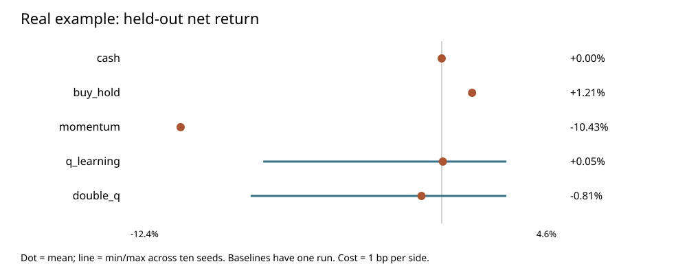
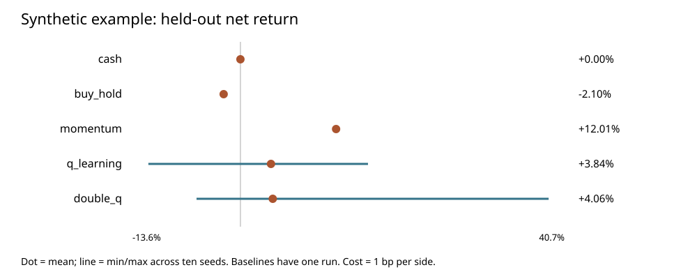

# Executed results

These results describe the committed datasets and fixed configuration; they are not evidence of a live trading edge.

## Real market example

Validation-selected policy: **cash**. Test: 2016-03-01 to 2020-03-18.

| Policy | Seeds | Mean net return | Min / max | Mean orders |
|---|---:|---:|---:|---:|
| cash | 1 | +0.00% | +0.00% / +0.00% | 0.0 |
| buy_hold | 1 | +1.21% | +1.21% / +1.21% | 2.0 |
| momentum | 1 | -10.43% | -10.43% / -10.43% | 220.0 |
| q_learning | 10 | +0.05% | -7.13% / +2.58% | 89.4 |
| double_q | 10 | -0.81% | -7.63% / +2.58% | 72.6 |

## Synthetic market example

Validation-selected policy: **q_learning**. Test: 2009-03-16 to 2011-07-01.

| Policy | Seeds | Mean net return | Min / max | Mean orders |
|---|---:|---:|---:|---:|
| cash | 1 | +0.00% | +0.00% / +0.00% | 0.0 |
| buy_hold | 1 | -2.10% | -2.10% / -2.10% | 2.0 |
| momentum | 1 | +12.01% | +12.01% / +12.01% | 106.0 |
| q_learning | 10 | +3.84% | -11.55% / +16.01% | 106.0 |
| double_q | 10 | +4.06% | -5.51% / +38.68% | 115.2 |

## Interpretation

On real EUR/USD data, validation selects cash. Mean Q-learning test returns are close to zero and below buy-and-hold; mean Double Q-learning returns are negative. On synthetic data, the simple momentum benchmark beats average learned-policy returns. Seed ranges measure training randomness on one market history, not uncertainty across independent market samples.

Both learning algorithms solve both fixed mazes optimally in all ten tested seeds. This is training on and evaluating each same maze, not generalization to unseen layouts.
